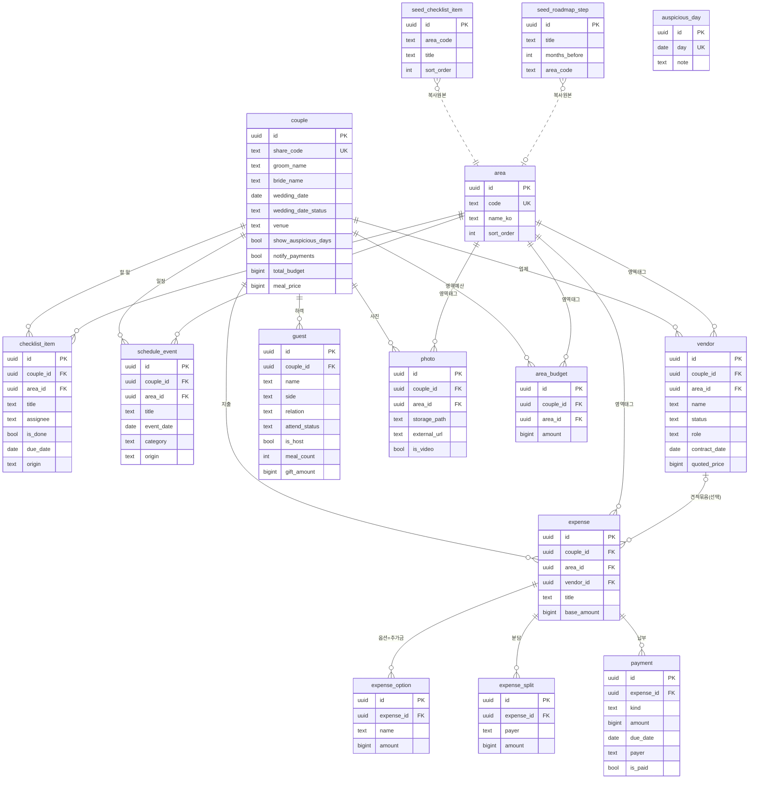

# ERD — 엔티티 관계도

전체 필드는 [table-definitions.md](table-definitions.md)가 단일 출처다. 이 문서는 **관계**를 본다.
렌더된 시각본: https://claude.ai/artifact/QLnL7pQHpZnipLwAsqKMSp

## 관계 읽는 법
- `couple ||--o{ *` — 커플 하나가 할일·일정·업체·지출·하객·사진을 여러 개 가진다(소유, `on delete cascade`).
- `area ||--o{ *` — 준비영역 하나가 여러 레코드에 태그로 붙는다(하이브리드 정보구조의 축).
- `vendor |o--o{ expense` — 지출은 업체에 **선택적으로** 묶인다. 업체 없는 직접 지출(청첩장 인쇄 등)은 `vendor_id`가 null.
- `couple ||--o{ area_budget` — 영역별 예산(영역당 1행, unique). 전체 예산은 `couple.total_budget` 컬럼.
- `expense ||--o{ expense_split` — 관계는 유지하나 **Phase 1 분담 정산은 `payment.payer`로 집계**한다
  ([ADR-0004](../decisions/0004-settlement-from-payments.md)) — `expense_split`은 당분간 미사용.
- `seed_* }o..|| area` — 점선은 FK가 아니라 **복사 원본** 관계. 설정 "표준 시드 불러오기"가 시드 행을
  커플의 `checklist_item`·`schedule_event`로 복사한다(원본은 안 바뀜).
- **달력 표시는 관계가 아니다**: 일정 화면 달력은 `payment.due_date`·`vendor.contract_date`를 직접
  조회해 점을 찍는다 — `schedule_event`로 복제 저장하지 않는다(중복 금지).
